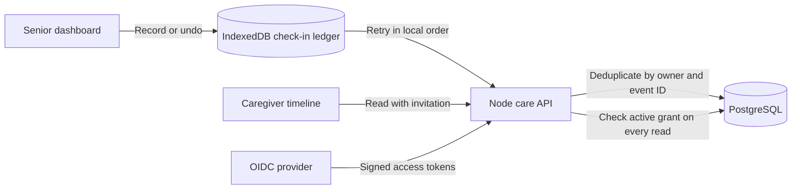

# SecondYouth — Offline-First Medication Check-ins with Consent-Based Caregiver Access

**Research question**

How reliably can an offline-first care app preserve self-reported medicine check-ins through interrupted connectivity, and how accurately can older adults and caregivers interpret its sync status?

## Architecture

An append-only IndexedDB ledger doubles as the pending queue. A check-in and its pending state commit together before the screen shows success. Each check-in carries a unique event ID, medicine ID and display name, scheduled local date and time, the recorded action, and timestamp. PostgreSQL records one event per owner and event ID. The browser marks an event synced only after receiving the matching acknowledgement. Undo creates another event and preserves the original action in the timeline.

The existing schedules and most recent taken dates remain readable. Legacy taken dates remain local and do not become shared history. Sharing applies to new check-ins recorded after opt-in. Pausing stops uploads from the device and leaves existing grants active until revocation or expiry. The timeline displays the latest 200 events in server receipt order. A missing check-in leaves the dose status unknown.

## Run the two-browser demonstration

Run `docker compose -f infra/docker/compose.yml up --build` from the repository root to start the app with PostgreSQL on loopback port 8787. The local Compose setup includes a demo database and stores records in a named volume.

For a host-based setup, start a local PostgreSQL 17 instance and use an empty development database. Run `npm ci` and `npm run build`, then start the Node server with `DATABASE_URL` and `CARE_DEMO=true`. The server creates the care tables during startup. Open the server on loopback, port 8787 by default. Use fictional data. In demo mode, a device-generated credential identifies the owner and the invitation link grants access to whoever holds it.

1. Complete local onboarding and create a fictional medicine.
2. Open **Settings → Care sharing**. Enable check-in sync and create an invitation. Open the link in a second isolated browser profile.
3. Wait for the service worker to control the senior dashboard. Set only that browser offline and mark the medicine taken. Reload offline, reopen the dashboard, and verify **Saved on this device · Awaiting sync**.
4. Reconnect and wait for **Synced**. Refresh the caregiver timeline and confirm a single matching entry.
5. Mark and undo a fictional check-in offline, then reconnect. Verify the caregiver can see the correction.
6. Revoke the link in **Care sharing** and refresh the caregiver timeline. The next request should deny access.

## Configure managed sign-in

Use an OIDC public SPA client with authorization code and PKCE. Register the dashboard root as a redirect URI and allow its origin for token and discovery requests. Configure the provider to issue signed JWT access tokens for the care API. The issuer hosts browser discovery and token endpoints on the same origin for the app's Content Security Policy.

| Environment variable | Purpose |
| --- | --- |
| `DATABASE_URL` | PostgreSQL connection URL |
| `CARE_OIDC_ISSUER` | Exact token issuer and browser discovery authority |
| `CARE_OIDC_CLIENT_ID` | Public SPA client ID |
| `CARE_OIDC_AUDIENCE` | Expected JWT API audience |
| `CARE_OIDC_JWKS_URI` | Provider signing key endpoint |
| `CARE_OIDC_SCOPE` | Requested scopes, defaulting to `openid profile` |
| `CARE_OIDC_RESOURCE` | Optional OAuth resource indicator for providers that require it |

Run over HTTPS outside localhost. The first signed-in caregiver to redeem a link binds it to their account. Other accounts cannot read from that link after redemption. Revocation applies to future reads. Use the dashboard's **Care sharing** sign-in to connect the browser to the identity provider.

## Deploy the web app on Vercel

The checkout includes a Vite build and a same-origin care function. Deploy it to the SecondYouth project with `main` as the production branch, and register the public site root as a redirect URI with the identity provider. Add the PostgreSQL and OIDC variables above in the Vercel project settings, then redeploy. Leave `CARE_DEMO` unset for production. The dashboard's device-local features are available without these bindings. Care sharing becomes available after the database and identity provider are configured.

## Evaluation protocol

| Experiment | Record |
| --- | --- |
| Disconnect, record, and reload before reconnecting | Expected and received event counts, plus time from reconnect to caregiver visibility |
| Let PostgreSQL commit, then drop the acknowledgement | Attempt count and duplicate count for the event ID |
| Record and undo while offline | Order and final state shown on the device and caregiver timeline |
| Revoke access with the caregiver timeline open | Outcome and time to next denied read |
| Ask participants to interpret local, synced, and missing check-ins | Task completion, errors, and participant interpretation using fictional data |

Run the PostgreSQL integration test with `CARE_TEST_DATABASE_URL` pointed to an isolated test database and execute `npm run test:server`. The test signs JWTs with a local test key and verifies audience checks, grant ownership, retry deduplication, corrections, persistence across service restart, and revocation.
